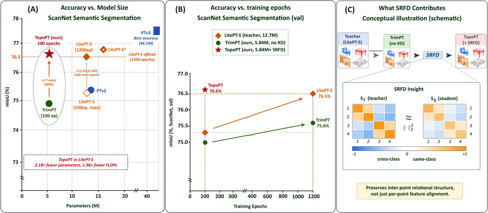
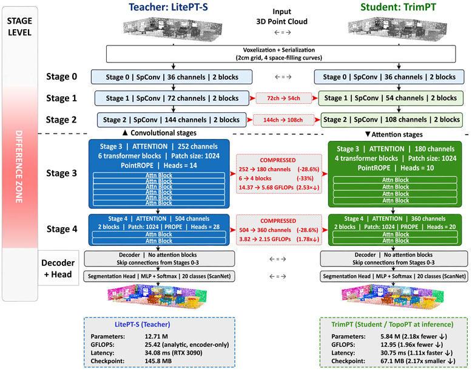
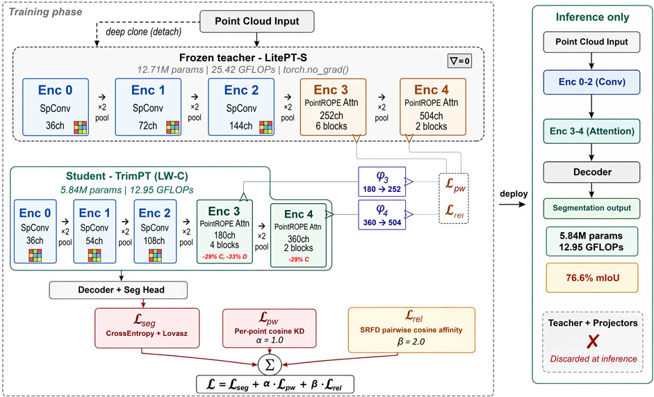
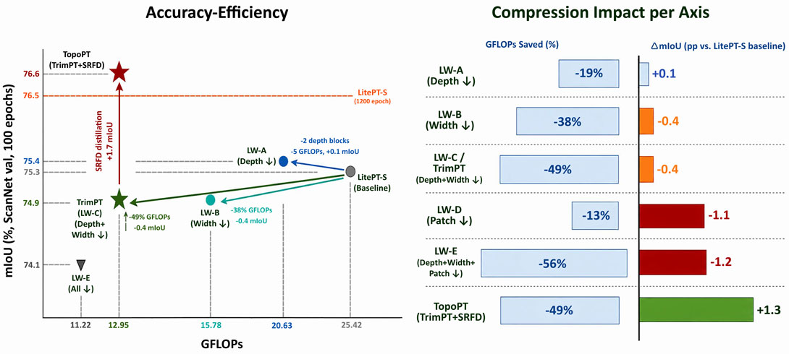

<div align="center">

<h1>Relational Feature Distillation<br>for Lightweight 3D Point Cloud Segmentation</h1>

**NeurIPS 2026 &nbsp;·&nbsp; Main Track (Poster)**

[Mohammad Saeid](http://m-saeid.github.io/) &nbsp;·&nbsp; [Amir Salarpour](https://asalarpour.github.io/) &nbsp;·&nbsp; [Pedram MohajerAnsari](https://pedram-mohajer.github.io/) &nbsp;·&nbsp; [Mert D. Pesé](https://mpese.com/)

<br>

<a href="https://m-saeid.github.io/TopoPT/"></a>

<a href="https://huggingface.co/cogniperceptai/TopoPT"></a>
<a href="https://github.com/m-saeid/TopoPT"></a>
<a href="LICENSE"></a>

<p>
<a href="https://m-saeid.github.io/TopoPT/">Project page</a> &nbsp;|&nbsp;
<a href="https://m-saeid.github.io/TopoPT/#slides">Slides</a> &nbsp;|&nbsp;
<a href="https://m-saeid.github.io/TopoPT/#poster">Poster</a> &nbsp;|&nbsp;
<a href="https://m-saeid.github.io/TopoPT/#presentation">Video</a> &nbsp;|&nbsp;
<a href="#model-zoo">Model zoo</a> &nbsp;|&nbsp;
<a href="#citation">Citation</a>
</p>

</div>

---

**TopoPT** is a lightweight 3D point cloud segmentation model. It is obtained by compressing [LitePT-S](https://github.com/prs-eth/LitePT) into a compact student architecture (**TrimPT**) and training that student with **Stage-wise Relational Feature Distillation (SRFD)**.

<div align="center">

| 5.84 M | 12.95 G | 76.6 % |
|:--:|:--:|:--:|
| parameters<br>**2.18× fewer** than LitePT-S | FLOPs<br>**1.96× fewer** than LitePT-S | ScanNet val mIoU<br>LitePT-S official: 76.5 |

<sub>Semantic segmentation. The instance-segmentation models have 7.6 M parameters.</sub>

</div>

- **TrimPT** compresses LitePT-S by reducing channel width and stage-3 attention depth while preserving the full 1024-token attention window. It reaches **5.84 M parameters** and **12.95 GFLOPs**: **2.18× fewer parameters** and **1.96× fewer FLOPs** than LitePT-S.
- **SRFD** is a training-only objective that matches pairwise cosine-similarity matrices between teacher (LitePT-S) and student (TrimPT) features at the compressed attention stages (stages 3 and 4). The teacher and projection heads are discarded after training, so **TopoPT has the same inference architecture, checkpoint size, FLOPs, and latency as TrimPT**.
- On **ScanNet semantic segmentation**, TopoPT reaches **76.6% mIoU**. This matches the official LitePT-S result (76.5%) with 2.18× fewer parameters and 1.96× fewer FLOPs.

<p align="center">
  
</p>

## Contents

- [News](#news)
- [Method](#method)
- [Results](#results)
- [Model zoo](#model-zoo)
- [Efficiency](#efficiency)
- [Getting started](#getting-started)
- [Training](#training)
- [Testing](#testing)
- [Talk, slides and poster](#talk-slides-and-poster)
- [Acknowledgments](#acknowledgments)
- [Citation](#citation)

## News

- **Sep 24, 2026:** Accepted at NeurIPS 2026 main track as a poster.

## Method

TopoPT has two components: a compressed student architecture (TrimPT) and a training-only distillation objective (SRFD).

### TrimPT: compressed student architecture

TrimPT is derived from LitePT-S through a controlled compression study across three axes: encoder depth, channel width, and attention patch size.

| Compression axis | Effect |
|:--|:--|
| Stage-3 depth (6 → 4 blocks) | Minor accuracy drop, meaningful FLOP reduction |
| Channel width (504 → 360 max) | Large compute saving, modest accuracy drop |
| Attention patch (1024 → 512) | Accuracy degradation with limited measured FLOP benefit |

TrimPT combines depth and width reduction while **preserving the 1024-token attention window**. This gives channels `(36, 54, 108, 180, 360)` and stage depths `(2, 2, 2, 4, 2)`.

<p align="center">
  
</p>

### SRFD: Stage-wise Relational Feature Distillation

SRFD is applied at stages 3 and 4, the compressed attention stages. At each stage, a learned projector maps student features to the teacher's dimension. The training loss combines two terms:

- **Pointwise loss** $L_{pw}$: cosine alignment of the projected student features with the frozen teacher features.
- **Relational loss** $L_{rel}$: Frobenius distance between the teacher and student pairwise cosine-similarity matrices, computed over a sampled set of up to 512 aligned tokens per stage.

The full training loss is

$$
L = L_{seg} + \alpha \, L_{pw} + \beta \, L_{rel}, \qquad \alpha = 1.0,\ \beta = 2.0
$$

After training, the teacher and projectors are discarded. **TopoPT inference is identical to TrimPT inference.**

<p align="center">
  
</p>

## Results

TopoPT improves on TrimPT at the same number of epochs on every benchmark, for both semantic and instance segmentation.

| Task | Benchmark | Metric | Epochs | TrimPT | **TopoPT** | Gain |
|:--|:--|:--:|--:|--:|--:|--:|
| Semantic | ScanNet | mIoU | 100 | 74.9 | **76.6** | +1.7 |
| Semantic | nuScenes | mIoU | 50 | 81.2 | **81.4** | +0.2 |
| Semantic | Structured3D | mIoU | 50 | 69.4 | **70.3** | +0.9 |
| Instance | ScanNet | mAP₅₀ | 100 | 63.1 | **63.9** | +0.8 |
| Instance | ScanNet200 | mAP₅₀ | 100 | 26.3 | **33.0** | +6.7 |

Longer training of TrimPT alone does not always close the gap. On ScanNet semantic segmentation, TrimPT reaches 75.6 mIoU after 1200 epochs, against 76.6 for TopoPT after 100. On ScanNet200, TrimPT reaches 31.7 mAP₅₀ after 800 epochs, against 33.0 for TopoPT after 100. On ScanNet instance segmentation, TrimPT trained for 800 epochs reaches 65.1, above the 63.9 of TopoPT at 100 epochs.

## Model zoo

All TopoPT and TrimPT checkpoints are available on [Hugging Face](https://huggingface.co/cogniperceptai/TopoPT).

### Semantic segmentation

| Model | Params | Benchmark | Epochs | val mIoU | Config | Checkpoint |
|:--|--:|:--:|--:|:--:|:--:|:--:|
| TrimPT | 5.8M | ScanNet | 100 | 74.9 | [link](configs/scannet/semseg-lw-c-100epoch.py) | [Download](https://huggingface.co/cogniperceptai/TopoPT/tree/main/scannet-semseg-lw-c-100epoch/model) |
| TrimPT | 5.8M | ScanNet | 1200 | 75.6 | [link](configs/scannet/semseg-lw-c-1200epoch.py) | [Download](https://huggingface.co/cogniperceptai/TopoPT/tree/main/scannet-semseg-lw-c-1200epoch/model) |
| **TopoPT** | **5.8M** | **ScanNet** | **100** | **76.6** | [link](configs/scannet/semseg-lw-c-kd-100epoch.py) | [Download](https://huggingface.co/cogniperceptai/TopoPT/tree/main/scannet-semseg-lw-c-kd-100epoch/model) |
| TrimPT | 5.8M | NuScenes | 50 | 81.2 | [link](configs/nuscenes/semseg-lw-c-50epoch.py) | [Download](https://huggingface.co/cogniperceptai/TopoPT/tree/main/nuscenes-semseg-lw-c-50epoch/model) |
| **TopoPT** | **5.8M** | **NuScenes** | **50** | **81.4** | [link](configs/nuscenes/semseg-lw-c-kd-50epoch.py) | [Download](https://huggingface.co/cogniperceptai/TopoPT/tree/main/nuscenes-semseg-lw-c-kd-50epoch/model) |
| TrimPT | 5.8M | Structured3D | 50 | 69.4 | [link](configs/structured3d/semseg-lw-c-50epoch.py) | [Download](https://huggingface.co/cogniperceptai/TopoPT/tree/main/structured3d-semseg-lw-c-50epoch/model) |
| **TopoPT** | **5.8M** | **Structured3D** | **50** | **70.3** | [link](configs/structured3d/semseg-lw-c-kd-tl-50epoch.py) | [Download](https://huggingface.co/cogniperceptai/TopoPT/tree/main/structured3d-semseg-lw-c-kd-tl-50epoch/model) |

### Instance segmentation

| Model | Params | Benchmark | Epochs | mAP₅₀ | Config | Checkpoint |
|:--|--:|:--:|--:|:--:|:--:|:--:|
| TrimPT | 7.6M | ScanNet | 100 | 63.1 | [link](configs/scannet/insseg-lw-c-100epoch.py) | [Download](https://huggingface.co/cogniperceptai/TopoPT/tree/main/scannet-insseg-lw-c-100epoch/model) |
| TrimPT | 7.6M | ScanNet | 800 | 65.1 | [link](configs/scannet/insseg-lw-c-800epoch.py) | [Download](https://huggingface.co/cogniperceptai/TopoPT/tree/main/scannet-insseg-lw-c-800epoch/model) |
| **TopoPT** | **7.6M** | **ScanNet** | **100** | **63.9** | [link](configs/scannet/insseg-lw-c-kd-100epoch.py) | [Download](https://huggingface.co/cogniperceptai/TopoPT/tree/main/scannet-insseg-lw-c-kd-100epoch/model) |
| TrimPT | 7.6M | ScanNet200 | 100 | 26.3 | [link](configs/scannet200/insseg-lw-c-100epoch.py) | [Download](https://huggingface.co/cogniperceptai/TopoPT/tree/main/scannet200-insseg-lw-c-100epoch/model) |
| TrimPT | 7.6M | ScanNet200 | 800 | 31.7 | [link](configs/scannet200/insseg-lw-c-800epoch.py) | [Download](https://huggingface.co/cogniperceptai/TopoPT/tree/main/scannet200-insseg-lw-c-800epoch/model) |
| **TopoPT** | **7.6M** | **ScanNet200** | **100** | **33.0** | [link](configs/scannet200/insseg-lw-c-kd-100epoch.py) | [Download](https://huggingface.co/cogniperceptai/TopoPT/tree/main/scannet200-insseg-lw-c-kd-100epoch/model) |

### Ablation checkpoints

These checkpoints correspond to the compression ablation study in the paper (Table 2). All are trained for 100 epochs on ScanNet semantic segmentation.

| Model | Description | Params | mIoU | Checkpoint |
|:--|:--|--:|:--:|:--:|
| LitePT-S (repro) | Official arch, reproduced | 12.7M | 75.3 | [Download](https://huggingface.co/cogniperceptai/TopoPT/tree/main/scannet-semseg-litept-reruun-100epoch/model) |
| LW-A | Depth reduction only | 11.2M | 75.4 | [Download](https://huggingface.co/cogniperceptai/TopoPT/tree/main/scannet-semseg-lw-a-100epoch/model) |
| LW-B | Width reduction only | 6.6M | 74.9 | [Download](https://huggingface.co/cogniperceptai/TopoPT/tree/main/scannet-semseg-lw-b-100epoch/model) |
| LW-C (= TrimPT) | Depth + width reduction | 5.8M | 74.9 | [Download](https://huggingface.co/cogniperceptai/TopoPT/tree/main/scannet-semseg-lw-c-100epoch/model) |
| LW-D | Patch size reduction only | 12.7M | 74.2 | [Download](https://huggingface.co/cogniperceptai/TopoPT/tree/main/scannet-semseg-lw-d-100epoch/model) |
| LW-E | Depth + width + patch | 5.8M | 74.1 | [Download](https://huggingface.co/cogniperceptai/TopoPT/tree/main/scannet-semseg-lw-e-100epoch/model) |

<p align="center">
  
</p>

## Efficiency

Inference was profiled on an NVIDIA RTX 3090 (batch size 1, 300 forward passes after 10 warm-up iterations). TopoPT and TrimPT share the same deployed architecture, so their costs are the same.

| Dataset / Task | Model | Params (M) | GFLOPs | Latency (ms) | FPS | Mem (GB) | Size (MB) |
|:--|:--|--:|--:|--:|--:|--:|--:|
| ScanNet Sem. | LitePT-S | 12.71 | 25.42 | 34.08 | 29.34 | 1.332 | 145.8 |
| ScanNet Sem. | TrimPT | 5.84 | 12.95 | 30.75 | 32.52 | 1.211 | 67.1 |
| ScanNet Sem. | **TopoPT** | **5.84** | **12.95** | **30.78** | **32.49** | **1.211** | **67.1** |
| nuScenes Sem. | LitePT-S | 12.71 | 25.42 | 35.81 | 27.93 | 0.717 | 145.7 |
| nuScenes Sem. | TrimPT | 5.84 | 12.95 | 28.72 | 34.82 | 0.432 | 67.0 |
| nuScenes Sem. | **TopoPT** | **5.84** | **12.95** | **28.84** | **34.68** | **0.432** | **67.0** |

## Getting started

### Environment

TopoPT builds on the [LitePT](https://github.com/prs-eth/LitePT) codebase. Set up the environment following the LitePT instructions:

```shell
git clone https://github.com/m-saeid/TopoPT.git
cd TopoPT
conda create -n topopt python=3.10
conda activate topopt
# Install PyTorch (adjust for your CUDA version)
pip install torch==2.4.1 torchvision==0.19.1 --index-url https://download.pytorch.org/whl/cu124
# Install other required packages
pip install -r requirements.txt
# spconv (SparseUNet)
pip install spconv-cu124
# Flash attention
pip install git+https://github.com/Dao-AILab/flash-attention.git
```

**PointROPE.** Modify `all_cuda_archs` in `libs/pointrope/setup.py` to match your GPU architecture (for example 8.6 for an RTX 3090, 9.0 for an H100):

```shell
cd libs/pointrope
python setup.py install
cd ../..
```

A pure PyTorch fallback is available if CUDA compilation is not possible (slightly slower).

<details>
<summary><b>Optional requirements</b> (evaluator and PointGroup instance segmentation)</summary>

```shell
# Evaluator
cd libs/pointops && python setup.py install && cd ../..
# PointGroup
conda install -c bioconda google-sparsehash
cd libs/pointgroup_ops && python setup.py install && cd ../..
```

</details>

### Data

Data preparation follows [Pointcept](https://github.com/Pointcept/Pointcept#data-preparation). All datasets should be placed in `TopoPT/data`.

### Teacher checkpoint

SRFD requires a pretrained LitePT-S teacher. Download the appropriate checkpoint from the [LitePT model zoo](https://huggingface.co/prs-eth/LitePT) and place it as specified in the config file.

## Training

<details open>
<summary><b>Semantic segmentation</b></summary>

```shell
# ScanNet + TrimPT (no distillation)
sh scripts/train.sh -g 4 -d scannet -c semseg-lw-c-100epoch -n semseg-lw-c-100epoch

# ScanNet + TopoPT (SRFD)
sh scripts/train.sh -g 4 -d scannet -c semseg-lw-c-kd-100epoch -n semseg-lw-c-kd-100epoch

# NuScenes + TrimPT
sh scripts/train.sh -g 4 -d nuscenes -c semseg-lw-c-50epoch -n semseg-lw-c-50epoch

# NuScenes + TopoPT
sh scripts/train.sh -g 4 -d nuscenes -c semseg-lw-c-kd-50epoch -n semseg-lw-c-kd-50epoch

# Structured3D + TrimPT
sh scripts/train.sh -g 16 -d structured3d -c semseg-lw-c-50epoch -n semseg-lw-c-50epoch

# Structured3D + TopoPT
sh scripts/train.sh -g 16 -d structured3d -c semseg-lw-c-kd-tl-50epoch -n semseg-lw-c-kd-tl-50epoch
```

</details>

<details>
<summary><b>Instance segmentation</b></summary>

```shell
# ScanNet + TrimPT
sh scripts/train.sh -g 4 -d scannet -c insseg-lw-c-100epoch -n insseg-lw-c-100epoch

# ScanNet + TopoPT
sh scripts/train.sh -g 4 -d scannet -c insseg-lw-c-kd-100epoch -n insseg-lw-c-kd-100epoch

# ScanNet200 + TrimPT
sh scripts/train.sh -g 4 -d scannet200 -c insseg-lw-c-100epoch -n insseg-lw-c-100epoch

# ScanNet200 + TopoPT
sh scripts/train.sh -g 4 -d scannet200 -c insseg-lw-c-kd-100epoch -n insseg-lw-c-kd-100epoch
```

</details>

## Testing

The training pipeline automatically runs evaluation upon completion. For standalone testing with a pretrained checkpoint:

```shell
export PYTHONPATH=./
python tools/test.py \
    --config-file "${CONFIG_PATH}" \
    --num-gpus "${NUM_GPU}" \
    --options save_path="${SAVE_PATH}" weight="${CHECKPOINT_PATH}"

# E.g., ScanNet semantic segmentation with TopoPT:
# python tools/test.py \
#     --config-file configs/scannet/semseg-lw-c-kd-100epoch.py \
#     --num-gpus 4 \
#     --options save_path=exp/scannet/semseg-lw-c-kd-100epoch \
#               weight=exp/scannet/semseg-lw-c-kd-100epoch/model/model_best.pth
```

## Talk, slides and poster

The presentation video, the slides (viewable in the browser), and the NeurIPS 2026 poster are on the [project page](https://m-saeid.github.io/TopoPT/#presentation).

## Acknowledgments

TopoPT builds directly on [LitePT](https://github.com/prs-eth/LitePT) and its dependencies. We thank the authors of [Pointcept](https://github.com/Pointcept/Pointcept), [Point Transformer V3](https://github.com/Pointcept/PointTransformerV3), and [OpenPCDet](https://github.com/open-mmlab/OpenPCDet).

## Citation

If you find this work useful, please cite:

```bibtex
@inproceedings{saeid2026rfd,
  author = {Saeid, Mohammad and Salarpour, Amir and MohajerAnsari, Pedram and Pesé, Mert D},
  booktitle = {Annual Conference on Neural Information Processing Systems (NeurIPS'26)},
  title = {Relational Feature Distillation for Lightweight 3D Point Cloud Segmentation},
  year = {2026}
}
```

Please also cite LitePT, on which TopoPT is built:

```bibtex
@inproceedings{yuelitept2026,
    title={{LitePT: Lighter Yet Stronger Point Transformer}},
    author={Yue, Yuanwen and Robert, Damien and Wang, Jianyuan and Hong, Sunghwan and Wegner, Jan Dirk and Rupprecht, Christian and Schindler, Konrad},
    booktitle={IEEE/CVF Conference on Computer Vision and Pattern Recognition (CVPR)},
    year={2026}
}
```

## License

This project is released under the [MIT License](LICENSE). Questions or problems? Please [open an issue](https://github.com/m-saeid/TopoPT/issues).
